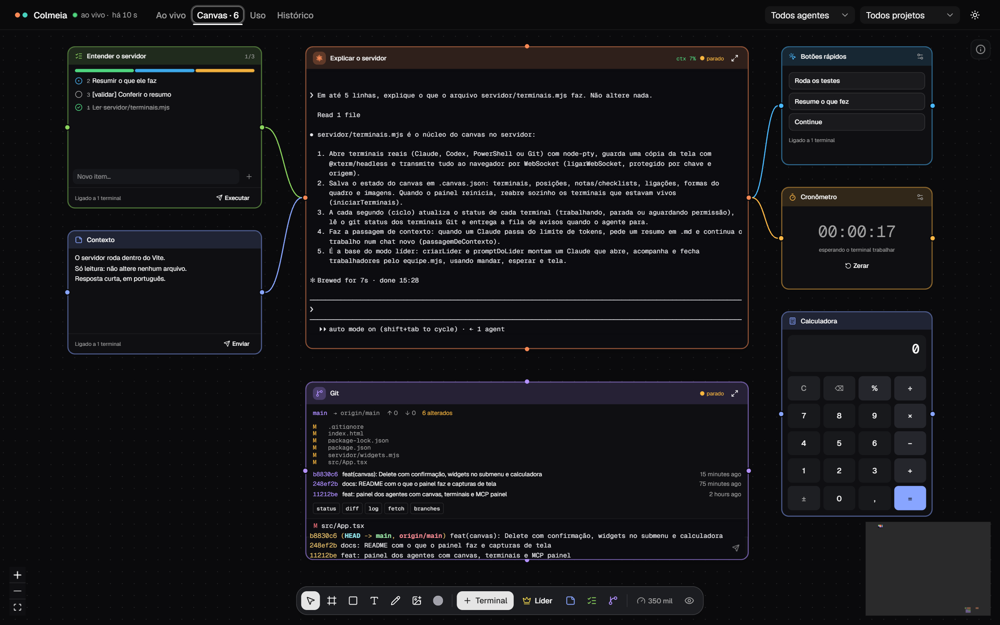
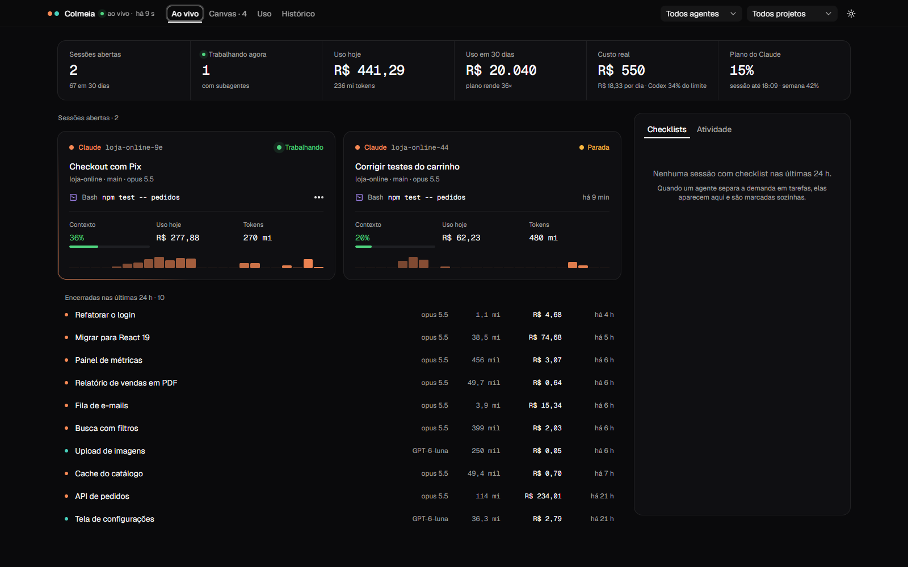
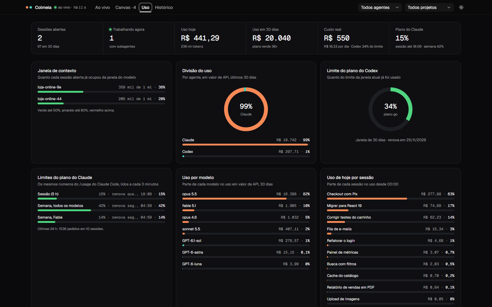
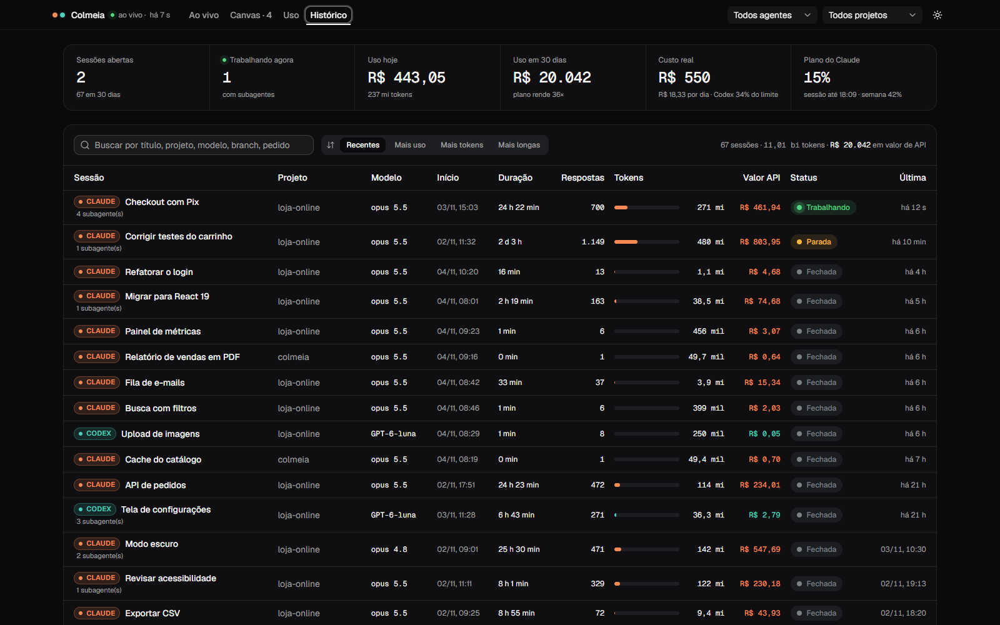

# Colmeia

**A central dos seus agentes de IA.** Acompanhe ao vivo as sessões do **Claude Code** e do **Codex** que rodam na sua máquina e trabalhe com elas num **canvas no estilo n8n**: os terminais dos agentes ficam abertos lado a lado, ligados a notas, checklists, janelas do Git e widgets.

Os agentes também mexem no canvas sozinhos, pelo MCP `painel`: criam notas e checklists, marcam itens, abrem a janela do Git antes de um deploy e abrem terminais trabalhadores ligados a eles.



> As capturas usam nomes de sessões e projetos de exemplo.

## O que tem

### Ao vivo

Sessões abertas, o que cada uma está fazendo agora, contexto usado, uso do dia em reais, tokens, subagentes e as checklists de cada agente sendo marcadas em tempo real.



### Canvas

- **Terminais de verdade** (Claude, Codex, PowerShell e Git) dentro do canvas: dá para ver a resposta e digitar direto no terminal. Colar, rolar e selecionar texto funcionam em qualquer zoom.
- **Notas e checklists** ligadas a um terminal arrastando do ponto, como no n8n. *Enviar* manda a nota para o agente; *Executar* manda a checklist e o agente marca cada item. A nota tem abas como o Bloco de Notas do Windows 11: + cria, duplo clique renomeia, x ou botão do meio fecha. Nota tem fundo azul e checklist verde; o botão direito troca a cor.
- **Vídeos e imagens dos agentes**: com o `mostrar_video`, o agente põe no canvas o que gerou (por exemplo, 5 versões de um vídeo), ligado a ele. Cada vídeo tem *Escolher esta versão*, e a escolha chega no terminal do agente.
- **Organizar**: um clique monta um frame por agente, com as notas e checklists à esquerda, o terminal no centro (subagentes, trabalhadores e vídeos embaixo) e o Git e os widgets à direita. O resto vai numa fila embaixo. Ctrl+Z desfaz.
- **Ir até o agente**: o botão de mira no dock lista os agentes e leva a visão até o frame de cada um. Tab vai ao próximo, Shift+Tab ao anterior e, segurando Tab, as setas andam só entre os que estão trabalhando. Com um terminal selecionado, o Tab fica com ele.
- **Janela do Git**: branch, à frente/atrás, arquivos alterados, últimos commits e um terminal na pasta.
- **Líder e trabalhadores**: o líder abre trabalhadores ligados a ele, espera, lê a tela de cada um e junta o resultado.
- **Subagentes** aparecem embaixo da sessão ou do terminal que os abriu e seguem junto quando ele é movido.
- **Migrar**: sessões abertas fora do painel são fechadas e retomadas dentro do canvas (`claude --resume`), continuando do ponto onde estavam.
- **Reabre sozinho**: ao reiniciar o painel, os terminais voltam e quem estava trabalhando recebe o pedido de continuar.
- **Passagem de contexto**: um Claude que passa do limite (350 mil tokens por padrão) escreve um resumo e continua num chat novo, no mesmo nó.
- **Widgets opcionais e ajustáveis** (botão direito › Widgets): validações pendentes, deploy (GitHub Actions), produção no ar (status, tempo de resposta e versão), botões rápidos que digitam no terminal ligado, cronômetro e calculadora (com teclado e as últimas contas).
- **Formas**: frame, retângulo, texto, imagem, vídeo (arraste um MP4 para o quadro) e lápis. O frame tem fundo sólido e sem borda, com cor e tom no botão direito, e o nome dele fica do mesmo tamanho na tela em qualquer zoom.
- **Atalhos**: Ctrl+Z e Ctrl+Shift+Z, Delete apaga o que estiver selecionado (terminal ou cronômetro contando pede confirmação), Espaço alinha os nós selecionados, Ctrl+roda dá zoom só no canvas, botão direito abre o menu do canvas, do nó ou da ligação, e a tesoura no meio corta uma ligação.

### Uso

Janela de contexto por sessão, divisão do uso entre Claude e Codex, limite do plano do Codex, os **mesmos limites do `/usage` do Claude Code** (sessão de 5 h e semana), uso por modelo, uso do dia por sessão e tipos de token.



### Histórico

Todas as sessões do período com busca por título, projeto, modelo, branch ou pedido, e ordenação por recentes, mais uso, mais tokens ou mais longas.



## Rodar

Feito e testado no Windows 10 com Node 24, Claude Code e Codex instalados.

```
git clone https://github.com/devcainan/colmeia.git
cd colmeia
npm install
npm run dev
```

O terminal mostra o endereço com a chave, por exemplo `http://192.168.0.10:5190/?chave=...`.

- Pela rede, as rotas `/api/*` só respondem com a chave. Pelo próprio PC (127.0.0.1), a leitura não pede chave.
- Terminais, canvas, blocos, ligações, formas e widgets pedem a chave **sempre**, até no 127.0.0.1, porque abrem processos.
- A chave fica em `.chave`. Apague o arquivo para gerar outra.
- `PAINEL_DIAS=7 npm run dev` muda o período lido (padrão: 30 dias).
- `npm run conferir` lê tudo uma vez e imprime o resumo no terminal, sem subir a tela.

## MCP `painel`

Ferramentas: `criar_nota` (com abas, se quiser), `editar_nota`, `criar_checklist`, `adicionar_itens`, `marcar_item`, `mostrar_video`, `ver_canvas`, `abrir_git`, `abrir_terminal`, `esperar_terminal`, `ler_terminal`, `mandar_terminal` e `fechar_terminal`. O que o agente cria nasce ligado ao nó dele no canvas.

Claude Code:

```
claude mcp add --scope user painel -- node C:/caminho/colmeia/servidor/mcp.mjs
```

Codex (`~/.codex/config.toml`):

```toml
[mcp_servers.painel]
command = "node"
args = ["C:/caminho/colmeia/servidor/mcp.mjs"]
```

Os terminais Claude abertos pelo painel também podem usar o `servidor/equipe.mjs` pela linha de comando (`abrir`, `lista`, `esperar`, `tela`, `mandar`, `marcar`, `fechar`).

## De onde vêm os dados (só leitura)

| Fonte | Arquivo |
|---|---|
| Sessões abertas do Claude | `~/.claude/sessions/<pid>.json` (status `busy`/`idle`, pid vivo) |
| Conversas do Claude | `~/.claude/projects/<proj>/<id>.jsonl` e `<id>/subagents/agent-*.jsonl` |
| Conversas do Codex | `~/.codex/sessions/AAAA/MM/DD/rollout-*.jsonl` e `~/.codex/session_index.jsonl` |
| Limites do plano do Claude | `claude -p /usage` a cada 3 minutos, numa pasta própria; a conversa gravada é apagada |

- Tokens do Claude: `message.usage` contado uma vez por `message.id`, porque a mesma resposta vem em várias linhas.
- Tokens do Codex: `token_count.total_token_usage` acumulado; o cache lido é descontado da entrada.
- Um fork do Codex começa com o histórico do pai copiado. O leitor ignora esse trecho até a thread própria começar (`thread_settings_applied`).
- Status do Codex é deduzido: tarefa começada e não terminada, com o arquivo mexido há menos de 10 min, conta como trabalhando.
- A leitura é incremental: cada arquivo é lido só do ponto onde parou. Os 30 dias (cerca de 1,2 GB) levam uns 5 s na primeira vez.
- O painel nunca escreve na conversa do Claude Code nem intercepta mensagens; os terminais do canvas são processos próprios dele.

## Custo estimado

- Tabela em `servidor/precos.json` (US$ por milhão de tokens, preço padrão da API). Editar o arquivo relê tudo sozinho.
- Claude: o custo é calculado por resposta, separando entrada, saída, cache gravado de 5 min e de 1 h (`usage.cache_creation`) e cache lido. Modo rápido conta 2×; Haiku 5.5 acima de 100 mil tokens usa a faixa cara.
- Codex: entrada sem cache, cache lido e saída (que já inclui o raciocínio).
- Dólar: AwesomeAPI (USD-BRL), a cada hora, salvo em `.cotacao` para quando estiver sem rede. `PAINEL_DOLAR=5.5` fixa um valor.
- É quanto custaria pela API. Quem usa assinatura não paga por token; o "custo real" é o valor do plano.

## Estrutura

- `servidor/leitor.mjs`: lê os arquivos das sessões e monta o resumo.
- `servidor/plugin.mjs`: rotas `/api/*` e SSE (`/api/eventos`) dentro do próprio Vite.
- `servidor/terminais.mjs`: terminais (node-pty + xterm headless), WebSocket, blocos, ligações, formas, Git e passagem de contexto. Estado do canvas em `.canvas.json`.
- `servidor/widgets.mjs`: widgets do canvas (deploy pelo GitHub Actions com a credencial do Git Credential Manager em memória, produção, botões e cronômetro).
- `servidor/uso-plano.mjs`: limites do `/usage` do Claude Code.
- `servidor/mcp.mjs` e `servidor/equipe.mjs`: MCP `painel` e linha de comando do líder.
- `src/`: React 19, Tailwind 4, shadcn, React Flow (`@xyflow/react`), xterm.js, `motion` e Recharts.
